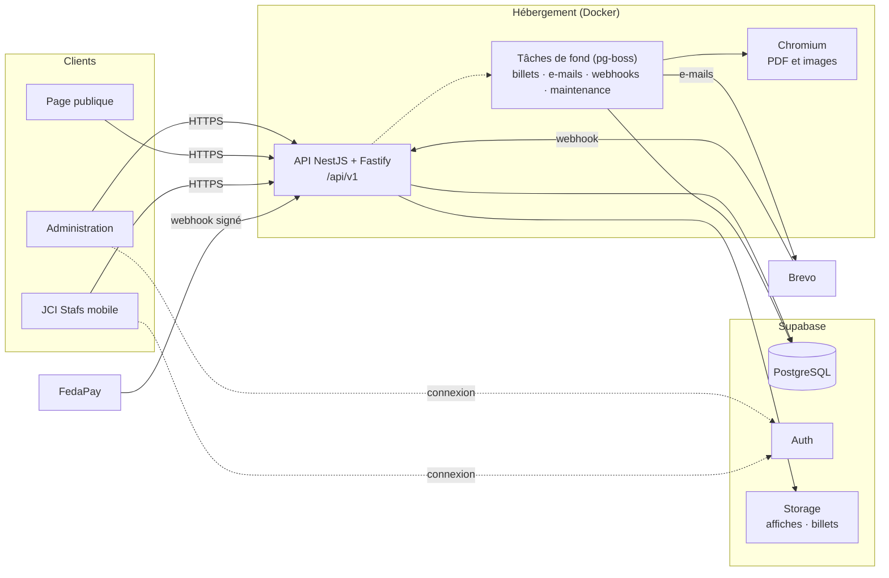

# JCI Labs : plateforme de billetterie et de gestion d'événements

API de la plateforme de **JCI Comé Excellence** (Bénin) : création et publication d'événements, vente de billets en ligne (paiement mobile via FedaPay) et au guichet, envoi des billets par e-mail, contrôle d'accès par QR code, suivi des ventes et des participants.

Ce dépôt contient **le backend**. Il est consommé par trois applications :

| Application | Utilisateurs | Rôle |
|---|---|---|
| **Administration** | Membres autorisés du bureau exécutif | Créer les événements, gérer la billetterie, suivre les ventes, les paiements et les participants |
| **Page publique de vente** | Participants et visiteurs | Découvrir un événement, acheter des billets, les recevoir |
| **JCI Stafs** (application mobile) | Membres de l'accueil | Scanner les QR codes à l'entrée, vérifier les billets, enregistrer les présences |

## Sommaire

[Fonctionnalités](#fonctionnalités) · [Architecture](#architecture) · [Stack technique](#stack-technique) · [Structure du dépôt](#structure-du-dépôt) · [Démarrage rapide](#démarrage-rapide) · [Configuration](#configuration) · [Tests](#tests) · [Qualité et garanties](#qualité-et-garanties) · [Rôles et droits](#rôles-et-droits) · [Documentation](#documentation) · [Déploiement](#déploiement) · [Feuille de route](#feuille-de-route) · [Contribuer](#contribuer)

## Fonctionnalités

- **Événements** : brouillon, publication, clôture, annulation ; affiches, catégories de billets, quotas, ouverture et fermeture de la billetterie (statut calculé) ; textes d'information avec repli sur un texte général JCI et FAQ.
- **Vente en ligne** : réservation des places (15 min), commande sans compte, paiement mobile FedaPay, protection anti-robots (Cloudflare Turnstile), idempotence des requêtes.
- **Vente physique** : un vendeur enregistre une vente au guichet (espèces, Mobile Money) ; le billet est remis en main propre ou envoyé par e-mail.
- **Billets** : PDF imprimable, image pour téléphone et visuel de partage WhatsApp, générés avec Chromium ; QR code à jeton aléatoire ; e-mails Brevo avec suivi de livraison ; renvoi et rattrapage automatique.
- **Contrôle d'accès** : scan d'un billet depuis l'application mobile, admission **unique même avec plusieurs téléphones en même temps**, rejeu sans double comptage, compteurs d'entrée en direct.
- **Pilotage** : participants (recherche, filtres, export CSV et Excel), vue d'ensemble d'un événement, tableau de bord global, paiements, annulation de billets.
- **Gouvernance** : cinq rôles, droits globaux ou limités à un événement, journal d'audit de toutes les actions sensibles.

## Architecture



- **Une seule image, deux modes.** Le même conteneur sert l'API HTTP et exécute les tâches de fond (`PROCESS_ROLE=all`). En production, on peut les séparer : `api` (reçoit les requêtes) et `worker` (`node dist/worker.js`, exécute les tâches).
- **Tâches fiables.** La file de tâches (pg-boss) vit dans PostgreSQL : un billet ou un e-mail n'est jamais perdu, chaque étape est rejouable. Une maintenance chaque minute revérifie les paiements en attente et relance les billets non livrés.
- **Authentification déléguée à Supabase.** Les clients se connectent avec le SDK Supabase ; l'API vérifie le jeton (JWKS), puis charge le profil et les rôles depuis ses propres tables.
- **Sécurité par défaut.** Row Level Security activé sur toutes les tables (l'API est le seul accès aux données), buckets de fichiers privés pour les billets, en-têtes de sécurité (Helmet), limitation de débit sur les routes publiques.

## Stack technique

| Domaine | Choix |
|---|---|
| Langage, framework | TypeScript, NestJS 11, Fastify |
| Base de données | PostgreSQL (Supabase), Prisma 6 |
| Authentification, fichiers | Supabase Auth, Supabase Storage |
| Paiement | FedaPay (mobile money) |
| E-mails | Brevo (API transactionnelle et webhooks) |
| Billets | Chromium headless (Puppeteer) : PDF et PNG ; QR code |
| Tâches de fond | pg-boss |
| Anti-robots | Cloudflare Turnstile |
| Contrat d'API | OpenAPI 3.0.3, vérifié par les tests |
| Tests | Jest (unitaires et bout en bout) |
| Déploiement | Docker ; Render (recette), VPS (Caddy) |

## Structure du dépôt

```
src/
  auth/           authentification, rôles, permissions (can / eventScope)
  users/ roles/   comptes et rôles
  events/         événements, affiches, textes par défaut
  ticketing/      paramètres de billetterie, catégories, stock
  sales/          commandes, paiement FedaPay, ventes physiques, pages publiques
  tickets/        billets : design, rendu Chromium, fichiers, e-mails Brevo
  checkin/        contrôle d'accès (scan, compteurs)
  participants/   liste, export CSV/Excel, fiche d'un billet
  overview/       vue d'ensemble d'un événement
  dashboard/      tableau de bord global
  jobs/           file de tâches et planificateur
  audit/          journal d'audit
  common/         erreurs, validation, limitation de débit, pagination
  config/         variables d'environnement (validées au démarrage)
prisma/
  schema.prisma   modèle de données
  migrations/     migrations Prisma
  migrations_sql/ contraintes, RLS, rôles et permissions (idempotent)
test/             tests de bout en bout et vérification du contrat
scripts/          administrateur initial, contrôle FedaPay, aperçu des billets
docs/             guides (voir « Documentation »)
openapi.yaml      contrat d'API
render.yaml       déploiement Render
Dockerfile · docker-compose.yml · Caddyfile
```

## Démarrage rapide

**Prérequis** : Node.js 22+, un projet Supabase (voir [docs/DEPLOIEMENT.md](docs/DEPLOIEMENT.md), étape 1), Chromium ou Chrome pour générer les billets.

```bash
cp .env.example .env                       # renseigner les valeurs (voir « Configuration »)
npm install
npx prisma migrate deploy                  # crée les tables
npm run db:sql                             # contraintes, RLS, rôles et permissions
npm run bootstrap:admin -- admin@jci-come.bj Prénom Nom   # premier administrateur
npm run dev                                # API sur http://localhost:3000/api/v1
```

- L'API répond sur `/api/v1/health`. La documentation navigable du contrat est dans [`docs/api.html`](docs/api.html).
- `npm run db:sql` est à relancer **après chaque migration Prisma** : il réactive le RLS sur les nouvelles tables et échoue si l'une d'elles n'est pas protégée.
- Avec un hébergeur sans IPv6, utiliser les adresses du *pooler* Supabase (voir [docs/DEPLOIEMENT.md](docs/DEPLOIEMENT.md)).
- Aperçu du design des billets, sans base de données : `npm run ticket:preview` (écrit dans `./preview/`).

### Commandes utiles

| Commande | Rôle |
|---|---|
| `npm run dev` | API avec rechargement automatique |
| `npm run dev:worker` | Tâches de fond seules |
| `npm run build` · `npm start` | Compiler · lancer la version compilée |
| `npm run typecheck` | Vérifier les types sans compiler |
| `npm test` · `npm run test:e2e` | Tests unitaires · tests de bout en bout |
| `npm run api:lint` · `npm run api:docs` | Valider le contrat OpenAPI · régénérer `docs/api.html` |
| `npm run fedapay:check` · `npm run fedapay:webhook` | Tester la liaison FedaPay |

## Configuration

Toute la configuration passe par des variables d'environnement, **validées au démarrage** (l'API refuse de démarrer si l'une est invalide). Le fichier [`.env.example`](.env.example) les documente toutes.

| Groupe | Variables principales | Obligatoire |
|---|---|---|
| Base de données | `DATABASE_URL`, `DIRECT_URL` | oui |
| Supabase | `SUPABASE_URL`, `SUPABASE_SERVICE_ROLE_KEY` | oui |
| Adresses | `PUBLIC_WEB_URL`, `ADMIN_WEB_URL`, `CORS_ORIGINS`, `ORG_CONTACT_PHONE` | oui (sauf le téléphone) |
| Paiement | `FEDAPAY_ENV`, `FEDAPAY_SECRET_KEY`, `FEDAPAY_WEBHOOK_SECRET` | oui |
| Anti-robots | `TURNSTILE_SECRET_KEY` | en production |
| E-mails | `BREVO_API_KEY`, `BREVO_SENDER_EMAIL`, `BREVO_WEBHOOK_TOKEN` | en production |
| Billets | `TICKETS_BUCKET`, `CHROMIUM_PATH`, `CHROMIUM_LOW_MEMORY` | non |
| Processus | `PROCESS_ROLE` (`all`, `api`, `worker`), `PORT` | non |

**Secrets.** Les clés `SUPABASE_SERVICE_ROLE_KEY`, `FEDAPAY_*` et `BREVO_*` ne vont **jamais** dans un front, dans l'application mobile ni dans le dépôt : `.env` est ignoré par Git. Les frontends n'ont besoin que de l'URL Supabase et de la clé publique `anon`.

## Tests

```bash
npm test          # ~145 tests unitaires, aucune base requise
npm run test:e2e  # ~100 tests de bout en bout, nécessitent PostgreSQL
```

Les tests de bout en bout tournent sur une base PostgreSQL **locale et jetable** (les tables sont **vidées** à chaque exécution) :

```bash
createdb jcitest && psql jcitest -f test/stub-supabase.sql   # simule le schéma auth de Supabase
DATABASE_URL=... DIRECT_URL=... npx prisma migrate deploy
DIRECT_URL=... npm run db:sql
TEST_DATABASE_URL=postgresql://... npm run test:e2e
```

Le rendu des billets utilise un vrai Chromium : définir `CHROMIUM_PATH` pour le test de vente.

**Le contrat d'API est vérifié par les tests.** Chaque réponse réelle est comparée à `openapi.yaml` (route, statut, types, champs obligatoires, énumérations, champs non documentés) : une route ajoutée sans être documentée fait échouer la suite. Une intégration continue (GitHub Actions) compile, lance les tests unitaires et valide le contrat à chaque push.

## Qualité et garanties

- **Un billet n'est émis que pour un vrai paiement.** Ni le navigateur ni le webhook ne sont crus sur parole : signature vérifiée, puis relecture de la transaction chez FedaPay, montant exact exigé, idempotence à trois niveaux. Détail : [docs/PAIEMENTS_FEDAPAY.md](docs/PAIEMENTS_FEDAPAY.md).
- **Pas de survente.** Réservation de stock par mise à jour atomique : 20 acheteurs simultanés pour 5 places donnent exactement 5 commandes (testé).
- **Pas de double entrée.** L'admission d'un billet est une opération atomique en base : 20 scans simultanés du même billet donnent une seule admission (testé). Les scans sont rejouables sans double comptage.
- **Rien ne se perd.** Chaque tâche est rejouée avec attente croissante ; la maintenance relance paiements, billets et e-mails en retard.
- **Moindre exposition.** Un événement hors du périmètre d'un utilisateur répond 404 (son existence n'est pas révélée) ; le visuel de partage ne contient jamais le QR code ni le nom complet ; les billets sont dans un stockage privé à liens temporaires ; le journal des scans ne conserve que les 6 premiers caractères du jeton.
- **Traçabilité.** Les actions sensibles écrivent dans `audit_logs` ; tous les scans sont journalisés (agent, appareil, heure).
- **Dates.** Saisies en heure locale (Africa/Porto-Novo, UTC+1), stockées en UTC.

## Rôles et droits

| Rôle | Périmètre | Usage |
|---|---|---|
| `ADMIN` | tous les événements | Tout, y compris la gestion des comptes |
| `PRESIDENT` | tous les événements | Création, publication, finances, annulations |
| `ORGANIZER` | ses propres événements | Crée des brouillons, gère billetterie et participants ; ne publie pas |
| `SELLER` | événements assignés | Enregistre des ventes physiques, voit uniquement les siennes |
| `GATE_AGENT` | événements assignés | Scanne les billets et voit les compteurs d'entrée |

Un rôle peut être global ou limité à un événement. La matrice complète des permissions est dans [`prisma/migrations_sql/0003_seed_roles.sql`](prisma/migrations_sql/0003_seed_roles.sql) et le [guide d'intégration](docs/GUIDE_FRONTEND.md).

## Documentation

| Document | Pour qui | Contenu |
|---|---|---|
| [`openapi.yaml`](openapi.yaml) · [`docs/api.html`](docs/api.html) | Toutes les équipes | Contrat d'API (56 opérations), version navigable |
| [`docs/GUIDE_FRONTEND.md`](docs/GUIDE_FRONTEND.md) | Équipes front et mobile | Parcours, droits, erreurs, correspondance écran par écran |
| [`docs/CHANGELOG.md`](docs/CHANGELOG.md) | Équipes front et mobile | Évolutions de l'API, changements cassants signalés |
| [`docs/DEPLOIEMENT.md`](docs/DEPLOIEMENT.md) | Exploitation | Mise en ligne pas à pas, exploitation, passage en production |
| [`docs/PAIEMENTS_FEDAPAY.md`](docs/PAIEMENTS_FEDAPAY.md) | Développement, exploitation | Configuration FedaPay, garanties, cas limites |
| [`docs/BILLETS_ET_EMAILS.md`](docs/BILLETS_ET_EMAILS.md) | Développement, exploitation | Design des billets, Brevo, livraison |

## Déploiement

Le dépôt est prêt pour un premier déploiement **gratuit** sur [Render](https://render.com) : `render.yaml` décrit le service (API et tâches de fond dans un seul conteneur), et [`docs/DEPLOIEMENT.md`](docs/DEPLOIEMENT.md) détaille les six étapes, de la préparation de Supabase à la liste de contrôle de recette.

Le palier gratuit **s'endort après 15 minutes** et dispose de **512 Mo** : adapté à la recette, pas à la vente de billets en conditions réelles. Le guide liste ce qu'il faut changer avant le premier événement (hébergement toujours allumé, clés FedaPay live, Turnstile, domaine d'envoi Brevo). Une alternative sur serveur privé est fournie (`docker-compose.yml` et `Caddyfile`).

## Feuille de route

| Étape | Contenu | État |
|---|---|---|
| Socle | Authentification, utilisateurs, rôles, événements, affiches, billetterie, audit | Fait |
| Ventes | Réservation, commandes, FedaPay, ventes physiques, annulation de billets | Fait |
| Billets | PDF, image, QR code, visuel de partage, e-mails Brevo, rattrapage | Fait |
| Pilotage | Participants et exports, vue d'ensemble, tableau de bord | Fait |
| Page publique | Textes par défaut, FAQ, données de la page de vente | Fait (API) |
| Contrôle d'accès | Scan atomique, compteurs (application JCI Stafs) | Fait (API) |
| À venir | Admission exceptionnelle, onglets Présences, Communication et Documents | Prévu |

## Contribuer

- **Le contrat d'abord.** Toute modification d'API met à jour `openapi.yaml` **dans le même commit** que le code, avec une ligne dans `docs/CHANGELOG.md` (les changements cassants sont signalés). `npm run api:docs` régénère `docs/api.html`.
- **Migrations.** Toute évolution du schéma passe par une migration Prisma, suivie de `npm run db:sql`. Ne jamais modifier une migration déjà appliquée.
- **Tests.** Une fonctionnalité s'accompagne de ses tests ; les règles critiques (paiement, stock, scan) ont des tests de concurrence.
- **Branches et commits.** Travailler sur une branche, ouvrir une *pull request* vers `main` (l'intégration continue doit être verte) ; messages de commit au présent, courts et explicites.
- **Secrets.** Ne jamais committer de `.env`, de clé ou de jeton ; en cas de fuite, révoquer la clé immédiatement.

---

*Dépôt privé : usage interne de JCI Comé Excellence.*
